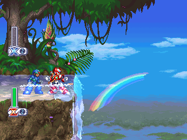
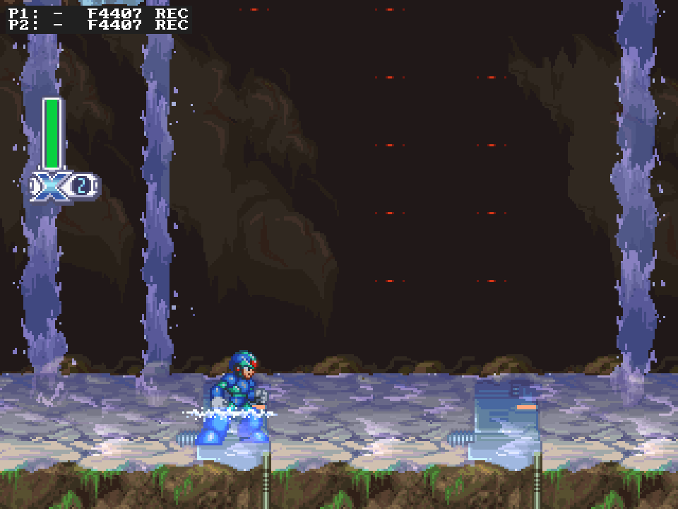
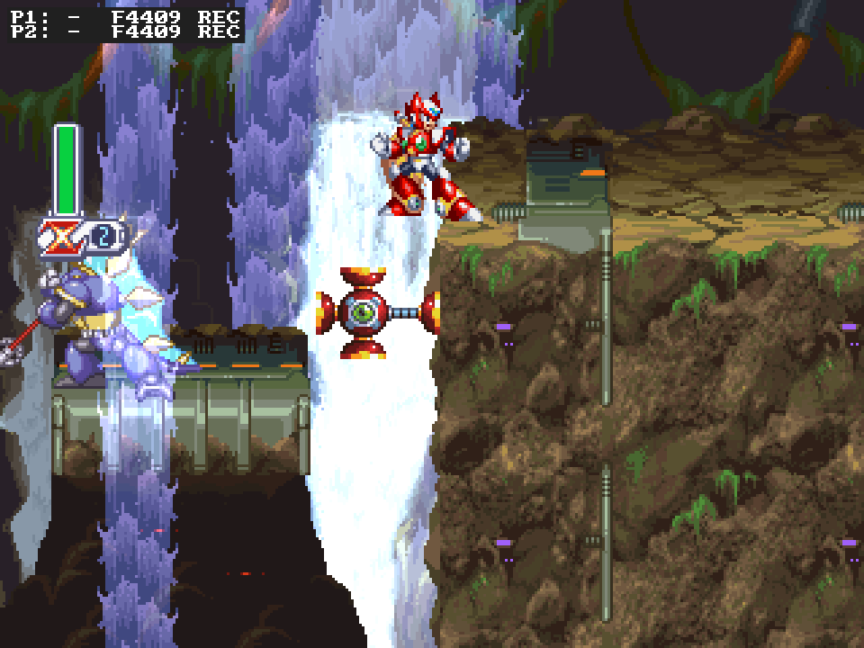
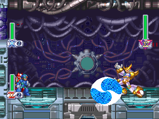
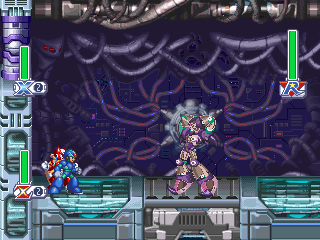
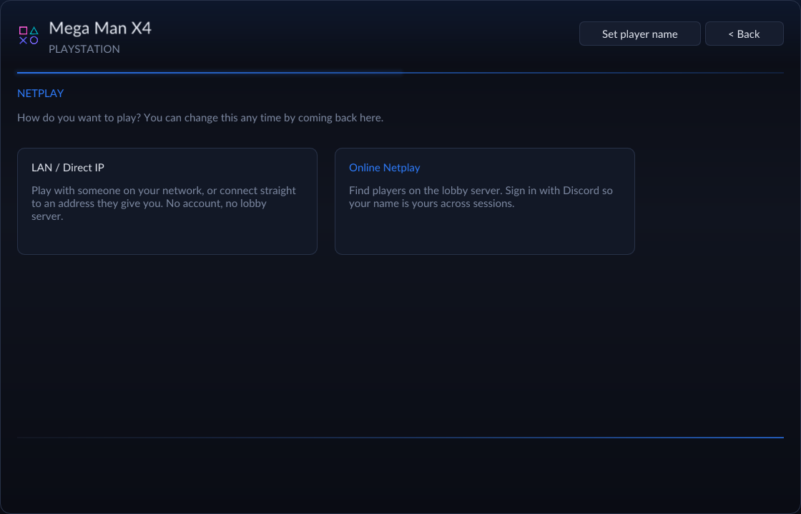
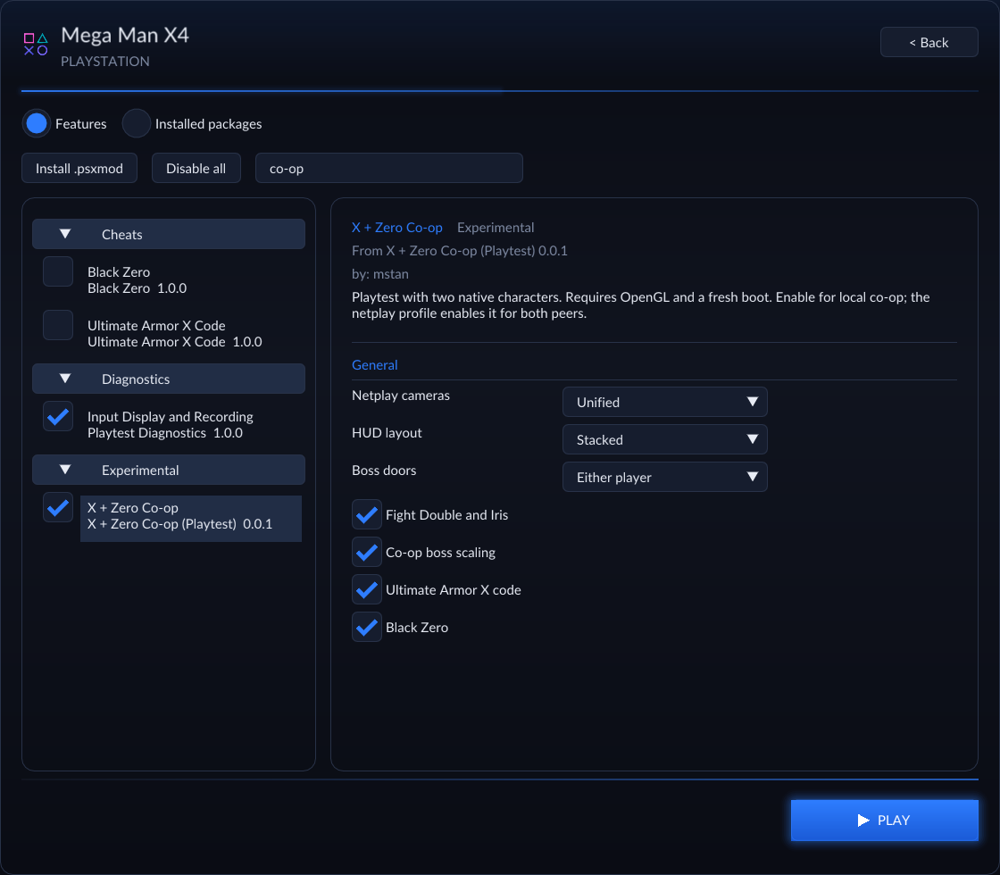

# Mega Man X4 Recompiled

**X and Zero. Together.**

Mega Man X4 on Windows and Linux, with **two-player co-op in alpha**.
Bring a friend through X's or Zero's campaign, on one computer or over netplay.

**[Download Playtest 17](https://github.com/mstan/MegaManX4Recomp/releases/tag/v0.1.1-coop-playtest.17)** · [What's new](RELEASE_NOTES.md) · [Known issues](docs/COOP_PLAYTEST_FEEDBACK_20261010.md)

  

## Two heroes, one campaign

Play X and Zero simultaneously, with their own attacks, voices and effects.
Player 1 owns the story, boss clears and permanent progress; Player 2 joins
as the other hero. Arrive together, tackle bosses together, and share team retries.

| Make it your co-op run | Choices |
| --- | --- |
| Play together | Local co-op with two controllers or separate keyboard bindings; two-player netplay from the launcher. |
| Pick your view | **Unified** camera by default. **Split (Experimental)** gives each netplay player an independent screen. Local play uses Unified. |
| Arrange your HUD | Stacked lifebars by default, or side by side. Independent screens show their own player's meter. |
| Set the door rule | Either player opens boss doors by default. Optionally wait for both living, present players. |
| Fight both story bosses | Opt into Double **and** Iris in sequence; return to the inner door for the second fight. |
| Turn up the challenge | Optional double effective boss health with shorter shared hit cooldowns. |
| Enable the secret codes | Ultimate Armor X's code and Black Zero can be enabled together. X still needs a capsule for the armor. |

The extra boss encounters, scaling and character codes are **off by default**.
The netplay host chooses the shared options.

  
  
   <em>One shared world, two independent netplay views. Split remains experimental.</em>

  
  
   <em>Double and Iris in one co-op run, when you enable the option.</em>

## Start playing

1. Download the **Windows ZIP** and extract it, or make the **Linux AppImage** executable and run it. Linux requires x86_64 and glibc 2.38 or newer.
2. Select your own **Mega Man X4 USA (SLUS-00561)** disc image. Choose the `.cue` from a `.cue` + `.bin` set. OpenBIOS is included; a separate BIOS dump is optional.
3. For **local co-op**, enable **Mods → X + Zero Co-op**, assign Player 1 and Player 2 in **Controls**, then press **Play**. For **netplay**, press **Netplay** and host or join using **X + Zero Co-op**. Both peers need the same release.

Co-op requires OpenGL and takes effect on a fresh game boot. Single-player remains available.

  

Offline co-op also supports **save states (F7)** and **rewind (F8)** when enabled.
The Mods page includes widescreen, character codes and an input display with
automatic playtest recordings. [Controls, saves and reporting guide →](docs/PLAYTESTING.md)

See the co-op settings

## Help improve the alpha

Expect bugs; independent cameras can still slow down. Online sign-in/startup
reports remain under investigation.
[Check the burndown](docs/COOP_PLAYTEST_FEEDBACK_20261010.md) or
[report a bug](https://github.com/mstan/MegaManX4Recomp/issues).

Keep **Playtest Diagnostics** enabled, reproduce the problem, quit normally,
and zip `saves/diagnostics` beside the executable or AppImage. Include a video
and the release version; for netplay, collect both computers' logs. These
recordings include starting game saves. [Details →](docs/PLAYTESTING.md#send-a-useful-bug-report)

---

Built with [PSXRecomp](https://github.com/mstan/psxrecomp) and
[recomp-ui](https://github.com/mstan/recomp-ui).
[Build and contribute](docs/DEVELOPMENT.md) · [R.A.I.D. community](https://discord.gg/Ad9BwSzctP)

Original project code is [MIT licensed](LICENSE). Dependencies retain their
own [licenses and notices](THIRD_PARTY_NOTICES.md). Mega Man X4 and the game
imagery belong to Capcom. You supply the game disc; this is an unofficial project.
