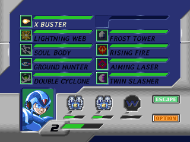
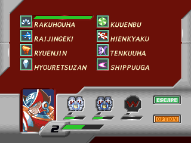

# Personal menus, E-tanks and Zero balance

October19. Tracking: `beads-or94`. Qualified for the next playtest; no release
number has been advanced by this change.

Each player's Start opens their character's retail menu, independently of
P1's campaign. The opener controls/resumes the menu, gameplay pauses for both,
and P2 cannot quit the campaign. This character projection already existed;
the added native checks qualify it rather than replace the menu implementation.

| X's weapons in Zero's campaign | Zero's techniques |
|---|---|
|  |  |

`Separate E-tank contents` is a default-off co-op option, available locally
and online. Acquisition stays with the single P1 campaign. Each seat projects
its own energy for native pickups, menu healing and tank compaction; W-energy
stays shared. P2 starts from the campaign's current energy when its inventory
is first initialized, then retains its supply through stages/rejoins and save
states. It does not create another memory-card campaign.

With boss scaling enabled, direct Zero boss damage now accumulates four tenths
of the retail amount instead of five tenths: 20% less than the existing scaled
damage. X retains five tenths. Fractions carry across accepted hits and across
either hero's attacks; rejected hits restore the prior carry. Both cooldown
methods use this rule. Original attack strength still drives weakness reactions,
and no contact/cooldown admission rule changes in this batch. Spider's delayed
web-severing penalty remains environmental and cannot inherit the current AI
target's character penalty.

The co-op snapshot provider advances to schema6 / X4PB for the extra tank fields
and tenth-HP carry. Old co-op save states are rejected; native memory-card save
format stays unchanged. The tank option is fixed/validated in snapshots and
included with private energy in the deterministic digest. Render transactions
restore the inventory with the rest of the private view state.

## Validation

| Check | Result |
|---|---|
| Windows build and all36 CTest checks | Passed, including ownership, snapshots, balance, package defaults and plugin/catalog audits. |
| Linux GCC portable lifecycle and balance executables | Both compile and pass. |
| Original-disc X/Zero menu art in both campaigns | Visually checked, including X/P2 in Zero's campaign. |
| Local8:3, Zero campaign, private tanks | Passed: both owners heal16 to32, only their own supply changes, other Start cannot steal the menu, P2 Select cannot quit, X/P2 selects/fires Lightning Web after resume. |
| P2 retains energy across a native stage reload | Passed locally and in Split LAN: after P1's supply is emptied, P2 can still consume its retained tank and heal16 to32. |
| Two real delay-sync peers, Split LAN, X campaign/private tanks | Passed; core/mod CRCs match, shared state acknowledged through7106. Both peers show the correct menus and resume gameplay. |
| Two real delay-sync peers, Unified LAN, Zero campaign/default shared tanks | Passed; core/mod CRCs match, shared state acknowledged through5441. P2's tank use consumes the shared supply as before. |
| Saved native Frost fight, identical348-frame controller routes | Passed; first60 setup observations agree, native save/load succeeds. Scaling-on accepts36 raw Zero damage and applies14 HP, with fractional carry retained. Native attack/recovery captures were inspected. |
| Both seats, cooldown methods, small/mixed/rejected hits, snapshot restoration | Unit contracts pass. X/unscaled damage retains its original behavior. |

The saved-fight control finishes at39 HP with scaling off and34 with it on.
That compares the whole experience, including shorter recovery and additional
accepted contacts; it is not a claim that the same hits occurred in both trials.
For the new20% adjustment,36 raw damage would previously remove18 scaled HP;
it now credits14.4. The native integer meter displays14 lost HP and carries
the remaining fraction toward a later hit.

Reproducible receipts and captures are under `build-pr23/personal40/`:
`private-zero-split`, `shared-x-unified`, `net-private-x-split` and
`net-shared-zero-unified`. The first two report files also preserve unrelated
or corrected harness failures: the local menu case passes independently of a
Jet checkpoint setup failure; the Frost damage case passes independently of
an unsafe mid-projection campaign read in the following menu case. The final
network checks use the completed canonical mirror for that observation.

Fixtures only set up positions/resources/progress for these bounded checks.
Menu navigation, healing, weapon selection and attacks use original executable
code and controller inputs. Network setup uses agreed development input packets,
with no direct RAM writes or network save-state loads. All launches were muted
and on an invisible desktop. This does not qualify Internet lobby connectivity
or a full-game playthrough.

Development-build commands:

```text
python tools/test_mmx4_coop_regressions.py --exe <debug-exe> --bios <bios> --disc <cue> --output <new-folder> --campaign 1 --local-cameras split --separate-etanks --hidden-window --cases personal_menus
python tools/test_mmx4_coop_netplay_debug.py --exe <debug-exe> --bios <bios> --disc <cue> --output <new-folder> --campaign 0 --cameras split --frontend hidden-window --separate-etanks --personal-menus-only
```

Tested Windows executable SHA256:
`09749d91a6c85017c6495ffcce7992b3923fd2eedafa1e02acec446e2d8da53f`.
